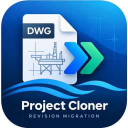

# Gamma → Nederwiek Revision Migration (0.4C.22)

Windows desktop app (PySide6) that migrates Gamma AutoCAD drawing bundles into the Nederwiek destination structure. It drives `accoreconsole.exe` (AutoCAD Core Console) with the AutoLISP scripts in `lisp/`; source drawings are never modified.

---

## Contents

- [What it does](#what-it-does)
- [Requirements](#requirements)
- [Quick start — run from source](#quick-start--run-from-source)
- [Release guide — packaging and shipping](#release-guide--packaging-and-shipping)
- [Workflow (the UI)](#workflow-the-ui)
- [Antivirus and SmartScreen](#antivirus-and-smartscreen)
- [Throughput](#throughput)
- [Output](#output)
- [Troubleshooting](#troubleshooting)
- [Tests](#tests)
- [Current limitations](#current-limitations)

---

## What it does

- Scans source folders for DWG, XLS/XLSX, NC1 and DXF, and derives drawing identity/revision from file names.
- Builds the canonical `<destination>/<bundle>/{A,00}/...` tree and copies both embedded raster assets into every CAD folder.
- Clones supporting files (Part List, NC1, DXF) with a selectable collision policy.
- Discovers title-block fields and builds a spatial revision plan for the A and 00 outputs.
- Writes A/00 drawings in Core Console (QSAVE only), validates them by reopening, publishes atomically with backups and journals, then plots PDFs.
- Every stage writes a report/checkpoint under `_GNI_REPORTS`; those files are also the contract between stages and the resume mechanism.

## Requirements

| Item | Requirement |
| --- | --- |
| OS | Windows 10 / 11, 64-bit |
| AutoCAD | **AutoCAD 2027** (verified). 2018+ expected to work; the Core Console engine (`accoreconsole.exe`) must be present. |
| Python | 3.10+ — only for running from source. The portable build bundles its own Python 3.12. |
| `uv` | Package manager used by `run_app.bat`. Installed automatically on first launch. |
| Rasters | `resources/reference_images/SEAtrium_Ge_.PNG` and `resources/reference_images/Tennet LogO New.PNG` — both must exist. |
| RAM | ~1–2 GB per parallel Core Console worker (the default is 4–6 workers). |

> **AutoCAD 2027 is required for the shipped default.** The app does not install, replace or launch the AutoCAD desktop application — it only calls `accoreconsole.exe`
> (typically `C:\Program Files\Autodesk\AutoCAD 2027\accoreconsole.exe`). The path is auto-detected when AutoCAD is in the default location; override it on the Setup tab if not.
> AutoCAD may be busy or unavailable while a migration runs; close other Core Console jobs first.

## Quick start — run from source

1. **Clone the repository.**

   ```bat
   git clone git@github.com:zendzo/Gamma-Nederwiek-Drawing-Cloner.git
   cd Gamma-Nederwiek-Drawing-Cloner
   ```

2. **Double-click `run_app.bat`** (or run it from a terminal).

   The launcher:
   - finds `uv.exe`, and installs it from `https://astral.sh/uv` when missing;
   - creates `.venv` with `uv venv`;
   - synchronizes `requirements.txt` (`PySide6>=6.7,<7`) into it;
   - starts `app_modern.py` (falls back to `app.py`).

3. **Manual start** once the environment exists:

   ```bat
   .\.venv\Scripts\python.exe app_modern.py
   ```

> **Do not run `uv run python app.py`.** There is no `pyproject.toml`, so `uv run` creates a separate ad-hoc environment that does **not** contain PySide6 and fails with
> `ModuleNotFoundError: No module named 'PySide6'`. Use `run_app.bat` or the `.venv` interpreter shown above.

Running from source is the recommended path for internal/developer machines: it never triggers the PyInstaller false positives described under [Antivirus and SmartScreen](#antivirus-and-smartscreen).

## Release guide — packaging and shipping

The portable build is produced by `packaging/build_portable.ps1` through the `repack.bat` wrapper. **Never call `pyinstaller` by hand** — an unsigned, unversioned build is not shippable.

### 1. Prerequisites on the build machine

- Windows 10/11 x64, Python 3.12, `uv`.
- Windows SDK `signtool.exe` (for signed builds).
- A code-signing certificate installed in `Cert:\CurrentUser\My`.
- Windows Defender enabled (the build runs a pre-scan).

### 2. Build commands

| Command | Purpose |
| --- | --- |
| `repack.bat` | Signed release build, label taken from `VERSION`. |
| `repack.bat -Version 0.4C.23` | Signed release build with an explicit label. |
| `repack.bat -NoSign` | Unsigned release zip (suffix `-unsigned`). Local testing only. |
| `repack.bat -Fast` | Iteration build: no clean, no signing, no zip; output in `dist\dev`. Never ship. |
| `repack.bat -Thumbprint <THUMB>` | Pick a specific certificate when several are installed (or set `GNI_CERT_THUMBPRINT`). |
| `repack.bat -SkipTests` | Emergency hotfix only — skips the unittest gate and says so loudly. |
| `repack.bat -SkipScan` | Skips the Defender pre-scan. Only on a build machine covered by another AV product. |

### 3. What the build does (in order)

The script is the release gate; any failing step aborts the build.

1. **preflight** — Python 3.12, `uv`, `signtool.exe`, signing certificate.
2. **build env** — reuses `.venv-build` (pinned `PySide6==6.12.0` + `pyinstaller>=6.11,<7`).
3. **test gate** — full `unittest` suite; a failure aborts the build.
4. **metadata** — `VERSION` file and `build_info.json` (git SHA, dirty flag).
5. **freeze** — PyInstaller **onedir** into a wiped `dist\`.
6. **selfcheck** — runs the built exe with `--selfcheck` before signing (fonts, LISP, resources, revision settings).
7. **sign** — `signtool sign` (SHA-256, RFC 3161 timestamp) then `signtool verify /pa`; verification failure aborts.
8. **AV scan** — Defender `MpCmdRun -ScanType 3 -DisableRemediation`; exit code 2 aborts the build.
9. **package** — copies `README-FIRST.txt`, `Verify-Build.ps1`, writes `SHA256SUMS.txt`, and creates the zip under `release\<version>\`.

### 4. Artifacts

```
release/<version>/GammaNederwiek-<version>-portable.zip          <- signed, shippable
release/<version>/GammaNederwiek-<version>-portable-unsigned.zip <- never distribute
dist/GammaNederwiek/                                            <- the built folder
```

The portable folder contains the **only file that is signed** — `GammaNederwiek.exe`:

```
GammaNederwiek/
    GammaNederwiek.exe
    _internal/        Python 3.12 + Qt 6 + resources/lisp/revision
    README-FIRST.txt
    Verify-Build.ps1
    SHA256SUMS.txt
    config/           created on first run (portable state)
    logs/             created on first run
```

### 5. Releasing

1. Bump `VERSION` (and `packaging/version_info.txt`) before the release build.
2. Run `repack.bat` and confirm every step reports OK, including `signature verified`.
3. Run the packaged check on a clean machine:

   ```powershell
   powershell -ExecutionPolicy Bypass -File .\Verify-Build.ps1
   ```

4. Distribute the **folder**, not the zip, when possible. Files extracted from a zip inherit Mark-of-the-Web and can trigger SmartScreen even when correctly signed. If a zip is unavoidable, the recipient runs `Verify-Build.ps1 -Fix`.
5. Keep `SHA256SUMS.txt` with the release so recipients can verify the bytes.

> **GitHub Packages does not help with antivirus blocking.** It is a package registry (NuGet, npm, Maven, container images, PyPI-compatible indexes), not a signing or
> reputation service. Publishing there adds no Authenticode signature and no SmartScreen reputation. The portable exe only becomes trustworthy through a real code-signing
> certificate (OV for a valid signature; EV for immediate SmartScreen trust).

### 6. Versioning and backups

- Each change step is archived as a flat `backup_before_<version>[_timestamp]/` folder at repo root containing only the files changed at that step.
- Version strings live in `VERSION`, `packaging/version_info.txt`, the Python stage constants (`PLAN_VERSION`, `WRITER_VERSION`, `PDF_PUBLISHER_VERSION`, `RUNTIME_VERSION`) and the LISP banners. Keep the LISP banner and its Python marker constant in sync or the run fails with `WRONG_LISP_VERSION`.

## Workflow (the UI)

The Setup tab is a pipeline, not a wall of buttons. It shows one table of the ten stages and one primary button that always names the next real action:

| Stage | Report it produces |
| --- | --- |
| Scan source | (in-session candidate groups) |
| Build destination | `destination_manifest.json` |
| Clone supporting files | `supporting_file_clone_report.json` |
| Discover title blocks | `title_block_discovery_fields.csv` |
| Build revision plan | `revision_pilot_write_plan.json` |
| Stable external writer | `stable_external_writer_report.json` |
| Reopen validator | `reopen_validation_report.json` |
| Atomic publish dry run | `atomic_publish_dry_run_report.json` |
| Atomic publisher | `atomic_publish_report.json` |
| Publish PDFs | `pdf_publish_report.json` |

1. Fill in Source, Destination root, Bundle name and `accoreconsole.exe` (saved to `config/settings.json`).
2. Press the primary button once. It runs every remaining non-destructive stage in order and stops at the publish gate: `Run migration to publish gate: <next stage>`.
3. Review the dry-run report in the Reports tab, then press `Publish N validated pair(s)`. The two publishing stages are never chained automatically.
4. Press `Publish PDFs` afterwards; it only plots pairs published by the atomic publisher.

Supporting behaviours:

- Completed stages are skipped. A stage whose report is older than its predecessor is shown as `STALE` and is re-run automatically, so changing an early input does not silently reuse downstream results.
- `Cancel Safely` stops after the current drawing/plot; finished work is kept through the checkpoints.
- `Parallel workers` (1–16, saved in settings) sets how many Core Console processes run at once for the writer, validator and PDF stages. 4–6 is a good default; each process needs roughly 1–2 GB of RAM.
- `Advanced — run or re-run one stage` (collapsed) exposes the ten individual stages for recovery or experimentation.
- `New Job` clears `_GNI_REPORTS` (reports, checkpoints, rejections) to start the next bundle. Published drawings, PDFs and `_GNI_BACKUP` are never touched.
- The Reports tab lists every `_GNI_REPORTS` file; double-click opens it.

## Antivirus and SmartScreen

The PyInstaller bootloader is heavily used by malware, so Defender heuristics can quarantine an unsigned build (`Wacatac`, `Trojan:Win32/*`). What actually removes the block:

| Approach | Cost | Effect |
| --- | --- | --- |
| Run from source (`run_app.bat`) | free | Avoids the bootloader entirely; internal/developer machines |
| **EV code-signing certificate** | ~$400–700/yr | Immediate SmartScreen trust |
| OV code-signing certificate | ~$200–400/yr | Valid signature; SmartScreen reputation ramps up |
| Submit the signed build to Microsoft | free | Clears false positives per build |
| Publisher rule via GPO (`Trusted Publishers` by thumbprint) | free, IT-dependent | Best option for company-wide deployment |

A self-signed certificate (for example Office `SelfCert.exe`) only helps when the machine trusts your root; it does not build reputation and is not a distribution solution. Use it solely as a rehearsal to prove the signing path before buying a real certificate.

## Throughput

Core Console startup costs about 5.5 s, so one process per drawing is dominated by startup, not by the edit or plot. The writer, validator and PDF publisher therefore run several independent drawings concurrently (`ThreadPoolExecutor`), and both the writer and the PDF publisher skip work that provably has not changed.

Measured on the three-drawing TEST-004 bundle (6 A/00 DWGs, 24 logical CPUs):

| Stage | 1 worker | 4 workers | Rerun with nothing changed |
| --- | --- | --- | --- |
| Stable external writer | 24.9 s | 11.3 s (2.2×) | reused from checkpoint |
| PDF publisher (cold) | 30.8 s | 19.3 s (1.6×, includes a 2-plot preflight) | 0.02 s (all skipped) |
| PDF publisher (steady state, no preflight) | — | 15.2 s | — |

Scaling is per drawing pair, so a 100-pair bundle at 4 workers is roughly 25 batches of ~15 s instead of 100 sequential pairs. The PDF preflight (first pair plotted alone to prove plotter/media are usable) is paid once per configuration change, never on ordinary reruns.

## Output

- Drawings and PDFs: `<destination>/<bundle>/{A,00}/{1. SP,2. AS,3. GA}/{CAD,PDF}`
- Supporting files: `00/4. PART LIST` and `00/5. NC1 & DXF`
- Reports and checkpoints: `<bundle>/_GNI_REPORTS` (shown in the in-app Reports tab; double-click to open)
- Transaction artifacts: `<bundle>/_GNI_STAGING` and `<bundle>/_GNI_BACKUP`
- Core Console jobs and logs: `%TEMP%\GNI\...`

## Troubleshooting

| Symptom | Cause / fix |
| --- | --- |
| `ModuleNotFoundError: No module named 'PySide6'` | You used `uv run`. Use `run_app.bat` or `.venv\Scripts\python.exe`. |
| Stage aborts with `*_NOT_FOUND` | `accoreconsole.exe` path is wrong, or a reference PNG is missing. |
| `WRONG_LISP_VERSION` | A `.lsp` banner was changed without updating the Python marker constant. |
| `ACAD_OBJECT_NOT_AVAILABLE` / plotting fails | ActiveX is unavailable in Core Console; PDF plotting must use the `-PLOT` command sequence. |
| Plot fails on paper size | Paper names must match exactly — `ISO_A1` is invalid, `ISO A1 (841.00 x 594.00 MM)` is correct. |
| SmartScreen "unrecognized app" | The file has Mark-of-the-Web. Run `Verify-Build.ps1 -Fix`, or distribute the unzipped folder. |
| No "Run anyway" button | Smart App Control / AppLocker is enforcing. Ask IT for a publisher rule by certificate thumbprint, not a file hash. |
| Settings do not persist | The folder is read-only; settings fall back to `%LOCALAPPDATA%\GammaNederwiek\config\settings.json`. |

Send `logs\app.log` and `build_info.json` with bug reports — together they identify the exact build and contain the error trace.

## Tests

```bat
.\.venv\Scripts\python.exe -m unittest discover -t . -s tests -v
```

The suite uses the standard-library `unittest` runner and does not need AutoCAD. The Windows preflight (`TRIGGER_REAL_ACAD.bat check`) additionally verifies `accoreconsole.exe`, both reference PNGs and the live LISP files.

## Current limitations

- Revision clouds / obsolete entities are not deleted; only detected revision-table rows are cleared.
- DXF files are copied, not content-migrated.
- PDF plotting uses single-page model space plus the media names in `revision/pdf_settings.json`. Paper names must match the plotter exactly (for example `ISO A1 (841.00 x 594.00 MM)`, no underscores).
- Two revisions of the same drawing are plotted sequentially inside one pair; concurrency is across pairs.

See `PLAN.md` for the roadmap and `AGENTS.md` for development notes.
